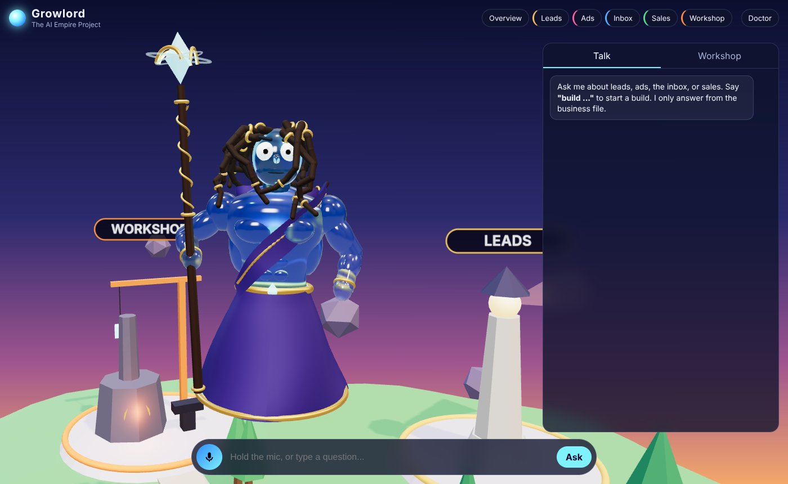

# Growlord

A one-page 3D command center for **The AI Empire Project**. Growlord, a muscular, robed glass figure with long locs, large eyes, and a staff, floats over an island with five districts: **Leads, Ads, Inbox, Sales, Workshop**. Ask him a question by voice or text. He answers **only from `business.md`**, speaks the answer, and flies the camera to the right district. Say **"build ..."** and he writes a brief, checks the coding agent, and waits for your approval before anything runs.

Everything runs on your computer. The server listens on `127.0.0.1` only.



Screenshots: [island overview](docs/island-overview.png), [failed build in the Workshop](docs/workshop-failed-build.png), [phone](docs/phone.png). A full `npm run demo` transcript is in [docs/demo-run.txt](docs/demo-run.txt).

---

## Setup (about 5 minutes)

You need **Node.js 20+** and **Chrome or Edge** (for push-to-talk).

```bash
git clone https://github.com/Brandonk318/empire.git
cd empire
npm install
cp .env.example .env        # then open .env and paste your XAI_API_KEY
npm run doctor              # checks everything (see below)
npm start                   # open http://localhost:4747
```

**Grok:** get an API key at console.x.ai and put it in `.env` as `XAI_API_KEY`. Set `GROK_MODEL` to a model your account has.
- If you'd rather use a Grok CLI, install one, leave the key empty, and set `GROWLORD_BRAIN=cli`.
- Growlord reads `grok --help` to find its prompt flag and never assumes one. `npm run doctor` shows what it found.

**Coding agent:** Claude Code. Install it with `npm install -g @anthropic-ai/claude-code`, run `claude` once, and type `/login`.

## The doctor command

```bash
npm run doctor                 # full check, including one tiny test call to the coding agent
npm run doctor -- --skip-agent # skip the test call
```

| Check | What it verifies |
|---|---|
| .env file | `.env` exists. Values are never printed. |
| business.md | File present, all core sections present, counts any `[FILL IN]` gaps |
| Grok CLI | Whether one is installed, plus its detected prompt, model and file flags |
| Grok brain | Which brain is in use. Validates `XAI_API_KEY` against xAI. |
| Coding agent | Installed, **logged in**, and **under its usage limit**, via a real one-line test call |
| Voice (TTS) | Whether a Kokoro server is reachable. If not, the browser voice is used. |
| Microphone | Checked in the browser: click **Doctor** in the page. It also tests mic permission, speech-to-text support and frame rate. |

## Using it

- **Talk:** hold the mic button, or hold **Space**, speak, and release. You can also type in the box.
- **Districts:**
  - Click a district or use the top buttons to fly there. **Overview** flies back out.
  - Click Growlord for a close-up.
  - Drag to orbit.
- **Answers:** these come only from `business.md`. If something isn't in it, he says *"That's not in the business file."*
- **Voice:**
  - With Kokoro running, the reply audio goes through a Web Audio analyser. His mouth, chest glow, body and staff crystal follow the sound.
  - Without Kokoro, the browser voice is used, and word-boundary events drive the same effects.

### "Build ..." flow

1. Say or type **"build ..."**, for example *"build a one-page flyer for the permit-readiness workshop"*.
2. Grok researches it and saves a brief to `briefs/YYYY-MM-DD-<slug>.md`.
3. **Pre-flight:** a tiny real call confirms the coding agent is installed, logged in, and under its limit.
4. The **Workshop** tab shows the brief with **Approve / Edit / Reject**.
5. Only after **Approve** does the build run, headless, in `builds/<brief-name>/`. Progress streams into the Workshop.
6. **If it fails:**
   - The brief is kept.
   - You see the exact reason: **Expired or missing login**, **Usage limit reached**, **Not installed**, **Timed out**, or **Other**, with the agent's own message.
   - You get the one command to run it by hand, and a **Retry** button.
7. Every step is logged to `logs/chain.log`, with keys scrubbed out.

## Safety

- **Keys:** they live only in `.env` (git-ignored).
  - Every log line is scrubbed of keys first.
  - Keys are never sent to the browser.
  - The xAI key is removed from the coding agent's environment.
- **Localhost only:**
  - The server binds to `127.0.0.1`.
  - It rejects requests whose `Host` isn't localhost, which blocks DNS-rebinding attacks.
  - It rejects cross-site `Origin`s.
  - Every API call needs a per-run session token that's only embedded in the page it serves.
- **Approval is enforced on the server** (`server/gate.js`), not just in the UI:
  - Every outbound action (build, email, post, publish) is created *pending*.
  - The only thing that runs it is the approve endpoint, and no route runs an executor directly.
  - The approval is tied to a hash of the exact brief. If the brief changes after approval, from the Edit button or on disk, it's blocked until you approve again.
  - Retry reuses an approval only if the brief is byte-for-byte unchanged.
  - Email, post and publish are not implemented in this version, so they stay blocked even after approval.
- **Builds stay in their folder:**
  - Builds run in `builds/<name>/`.
  - The default tool list (`BUILD_ALLOWED_TOOLS`) has file tools plus `ls`, `mkdir`, `cat` and `wc`. There's no open-ended shell, so a build can't `curl`, email, or `git push`. Widen it on purpose in `.env`, for example add `Bash(npm run:*)`.
  - The agent is told not to send, post, email, publish, deploy, or push.
  - If the server stops, any build it started is stopped too.

## Kokoro voice (optional)

```bash
python3 -m venv .venv && source .venv/bin/activate
pip install -r tts/requirements.txt     # pulls PyTorch, several GB
python tts/kokoro_server.py             # 127.0.0.1:8880; first run downloads the model
```

Restart `npm start` and the doctor shows **Voice (TTS) ✔**. Any OpenAI-compatible `/v1/audio/speech` server works too, such as Kokoro-FastAPI. Point `KOKORO_URL` at it.

## Tests and demo

```bash
npm test                      # offline: mock brain + a fake coding agent; covers routing, gate, login/limit failures
npm run demo                  # real setup: 3 questions, 1 approved build, 1 logged-out build
npm run demo -- --mock-brain  # same, without a Grok key
```

`npm run demo` approves its own test build through the same API the Approve button uses. That build is a local HTML flyer in `builds/`, and nothing is sent anywhere.

## Files

```
business.md            the only source of truth for answers
server/index.js        localhost server, routes, session/host/origin checks
server/gate.js         approval gate for every outbound action
server/brain.js        Grok via xAI API or detected CLI; strict JSON; mock for tests
server/agent.js        pre-flight, headless build, failure classification
server/checks.js       doctor checks (CLI + in-page)
public/                the page (Three.js loaded from node_modules, works offline)
public/growlord.js     the character, all procedural
public/world.js        island, districts, camera flights
tts/kokoro_server.py   optional local voice
```

## Known limits

- **Grok "research" uses Grok's own knowledge plus `business.md`.** The API path does not browse the web. A Grok CLI with web tools may.
- **Answers are only as complete as `business.md`.** It has no `[FILL IN]` markers, but it doesn't say: the sending Gmail address, the CRM link, workshop dates and partner schools, or the AI Office price. Ask about those and you'll get "not in the business file."
- **Push-to-talk needs Chrome or Edge.** It uses the Web Speech API, which in Chrome sends audio to Google for transcription. Firefox and some Safari versions don't support it, so use the text box there.
- **The browser-voice fallback only fakes the mouth movement.** It pulses on word-boundary events. Some voices don't send those, so a steady pulse is used instead. Only Kokoro audio drives the analyser for real.
- **Approvals live in server memory.** If you restart the server, pending actions are cleared. The briefs stay in `briefs/`, so say "build ..." again to re-queue one.
- **Email, post and publish are not built yet.** They exist only as blocked kinds in the approval gate.
- **Phone mode is lighter.** On phones the glass is see-through instead of truly transmissive, there are fewer locs, there are no shadows, and resolution drops automatically if the frame rate falls below about 45fps. Add `?quality=high` to force full quality, or `?lite` to force phone mode on a laptop.
- **The logged-out check in `npm run demo` uses a clean environment:** an allowlist of variables, a deliberately invalid key, and an empty config folder. It doesn't touch your real login. If a login still gets through, the demo stops before approving anything.
- **The default build tools are narrow.** Builds that need `npm install` or tests will report those steps as denied until you widen `BUILD_ALLOWED_TOOLS`.
